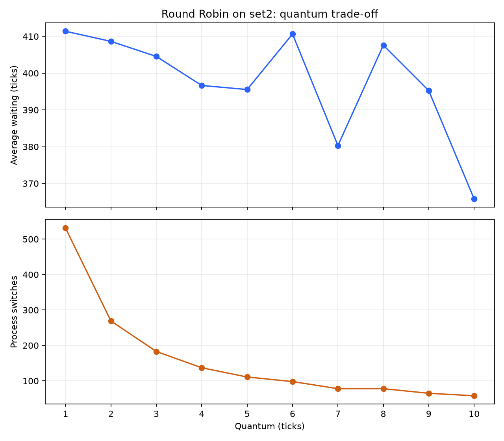
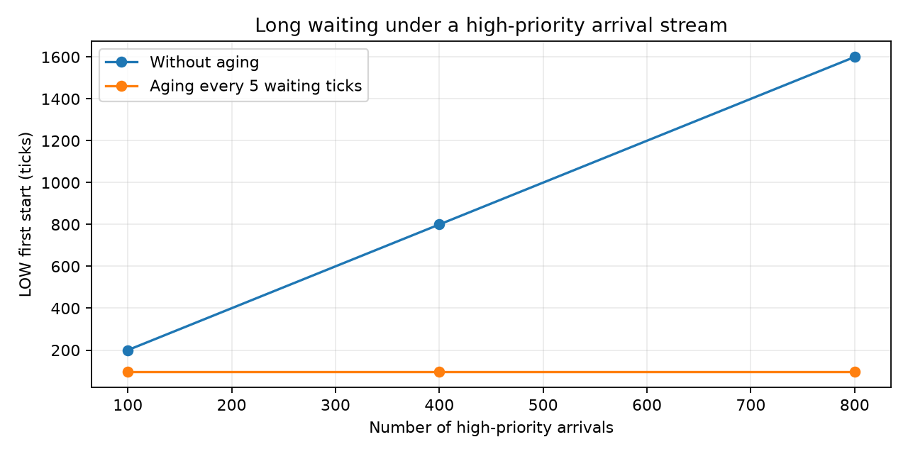

# Результаты и объяснения

## Модель и соглашения

- Один CPU; у каждого процесса один CPU-бёрст; I/O нет.
- Все значения времени — условные целые такты симуляции, а не длительность
  выполнения Python. `time`, загрузка реального Mac и число vCPU не нужны.
- Интервал `(a, b, PID)` означает выполнение на `[a, b)`.
- Меньший числовой приоритет означает более высокий приоритет.
- При одинаковом ключе в SRTF/Priority текущий процесс продолжает работать.
  Остальные равенства разрешаются по прибытиям и порядку строк файла.
- SJF без вытеснения выбирает кратчайший бёрст только среди уже прибывших.
- RR добавляет все новые процессы с arrival ≤ конец интервала раньше
  повторного добавления текущего незавершенного процесса.
- Aging повышает приоритет за накопленное ожидание в очереди готовых.
  Бонус не сбрасывается после запуска и может сделать приоритет отрицательным.
- Переключение — соседние интервалы разных PID без IDLE; начальный запуск,
  переходы через IDLE и продление кванта единственного процесса не считаются.
  Затраты времени на переключения не моделируются.
- Загрузка CPU считается на промежутке от t=0 до последнего завершения,
  включая начальный и промежуточный простой.

## Метрики

Для процесса i:

```text
turnaround_i = finish_i - arrival_i
waiting_i    = turnaround_i - burst_i
response_i   = first_start_i - arrival_i
CPU%         = 100 * sum(burst_i) / max(finish_i)
```

Средние — арифметические средние по всем процессам. Ожидание вычисляется
как оборот минус CPU-время, потому что в этой модели отсутствует I/O.

## Контрольный set1

Приоритеты 3, 1, 4, 2 выбраны для демонстрации: в условии их нет.
Это не влияет на FCFS, SJF, SRTF и RR.

| Алгоритм | Среднее ожидание | Средний оборот | Средний отклик | CPU, % | Переключения |
|---|---:|---:|---:|---:|---:|
| FCFS | 8,75 | 15,25 | 8,75 | 100 | 3 |
| SJF | 7,75 | 14,25 | 7,75 | 100 | 3 |
| SRTF | 6,50 | 13,00 | 4,25 | 100 | 4 |
| Priority | 6,50 | 13,00 | 4,25 | 100 | 4 |
| RR, q=3 | 13,50 | 20,00 | 3,00 | 100 | 9 |

SRTF:

```text
0–1 P1; 1–5 P2; 5–10 P4; 10–17 P1; 17–26 P3
```

RR, q=3:

```text
0–3 P1; 3–6 P2; 6–9 P3; 9–12 P4; 12–15 P1;
15–16 P2; 16–19 P3; 19–21 P4; 21–23 P1; 23–26 P3
```

**Несоответствие эталона FCFS в условии:**

```text
0–8 P1; 8–12 P2; 12–21 P3; 21–26 P4
wait = [0, 8−1, 12−2, 21−3] = [0, 7, 10, 18]
mean(wait) = 35/4 = 8,75
turnaround = [8−0, 12−1, 21−2, 26−3] = [8, 11, 19, 23]
mean(turnaround) = 61/4 = 15,25
```

Получить указанные в условии 9,25 / 15,75 при этих данных и обычном FCFS
нельзя. Код не изменяет метрики для подгонки. SRTF и RR совпадают с эталоном.
Совпадение Priority с SRTF в таблице обусловлено выбранными приоритетами;
в общем случае алгоритмы дают разные результаты.

## Квант RR на демонстрационном set2

set2 содержит 20 CPU-bound процессов с burst от 20 до 40. Файл с конкретными
строками преподавателя не предоставлен, поэтому использован детерминированный
генератор. Если заменить входные данные, численные результаты изменятся.

| q | Среднее ожидание | Средний отклик | Переключения |
|---:|---:|---:|---:|
| 1 | 411,40 | 8,55 | 531 |
| 2 | 408,65 | 17,10 | 269 |
| 3 | 404,55 | 26,60 | 183 |
| 4 | 396,65 | 35,20 | 137 |
| 5 | 395,55 | 44,75 | 111 |
| 6 | 410,65 | 53,30 | 98 |
| 7 | 380,30 | 62,80 | 78 |
| 8 | 407,60 | 71,40 | 78 |
| 9 | 395,25 | 80,90 | 65 |
| 10 | 365,80 | 89,50 | 58 |



Малый квант дает более быстрый первый отклик, но увеличивает число
переключений. При увеличении кванта с 1 до 10 переключения сокращаются
с 531 до 58, а отклик ухудшается с 8,55 до 89,50. Среднее ожидание меняется
немонотонно: оно зависит от прибытия процессов и остаточных длительностей.
Среди исследованных q минимальное ожидание дает q=10, но универсального
«лучшего кванта» по этому эксперименту выбрать нельзя.

В реальной ОС переключения имеют ненулевую стоимость: слишком малый квант
добавляет накладные расходы. В симуляторе эта стоимость равна нулю,
поэтому CPU=100% на наборах без простоя при любом q. Число переключений
здесь показывает потенциальные накладные расходы, а не измеряет их.

## Aging и голодание

Процесс LOW: arrival=0, burst=8, priority=10.
Каждый такт прибывает H с burst=2 и priority=0. Поток приносит больше
CPU-работы, чем CPU успевает выполнить. Без aging в очереди всегда есть
более приоритетная работа до завершения всего конечного набора H.

Используем:

```text
executed = burst - remaining
waiting = current_time - arrival - executed
effective_priority = priority - waiting // 5
```

Aging применяется ко всем ожидающим процессам, включая H; поэтому LOW
не обязательно запускается уже на такте 50, когда его приоритет достигнет 0.

| Число H | Aging | Первый запуск LOW | Завершение LOW | Ожидание LOW |
|---:|---:|---:|---:|---:|
| 100 | нет | 200 | 208 | 200 |
| 100 | 5 | 96 | 118 | 110 |
| 400 | нет | 800 | 808 | 800 |
| 400 | 5 | 96 | 118 | 110 |
| 800 | нет | 1600 | 1608 | 1600 |
| 800 | 5 | 96 | 118 | 110 |



На конечном наборе LOW все же завершится и без aging. Эксперимент показывает
растущее время ожидания при увеличении потока. Если тот же поток прибытий
продолжать бесконечно, без aging LOW никогда не получит CPU: это голодание.
С aging=5 LOW получает CPU на такте 96 и завершается на такте 118 даже при
продолжении потока: будущие прибытия не могут повлиять на уже завершившийся
процесс. Первый запуск и полное ожидание различаются, потому что LOW
может быть снова вытеснен после первого запуска.

## Ответы на контрольные вопросы

1. Для точного SJF нужно заранее знать длительность следующего CPU-бёрста.
   Реальная ОС обычно не знает ее; используются оценки по предыдущему
   поведению. В симуляторе burst дан во входном файле.
2. Если квант RR превышает все бёрсты, каждый процесс заканчивается за одно
   получение CPU, и RR становится эквивалентен FCFS для данной модели.

## Проверка

`python3 -m unittest -v`: 10 тестов, включая эталон SRTF/RR, арифметику FCFS,
приход процесса ровно на границе RR, вытеснение SRTF/Priority,
SJF без вытеснения, простой CPU, aging, сохранение CPU-времени и RR с большим
квантом. `python3 experiments.py` воспроизводит все таблицы и графики.
